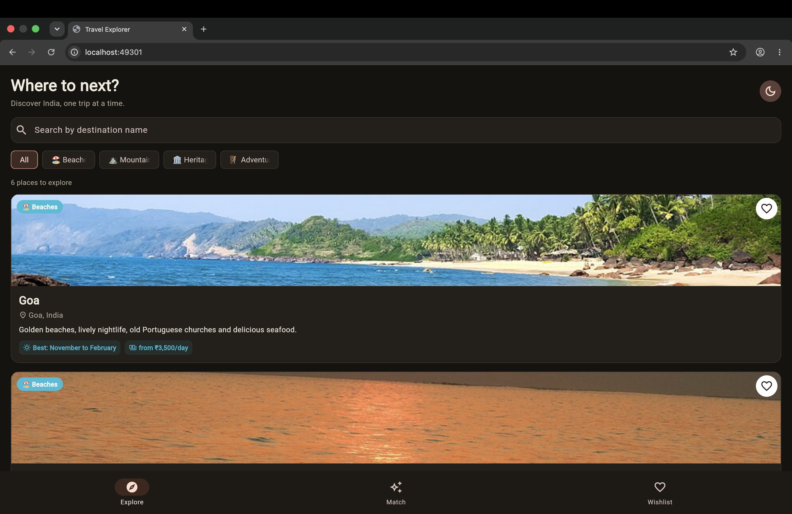
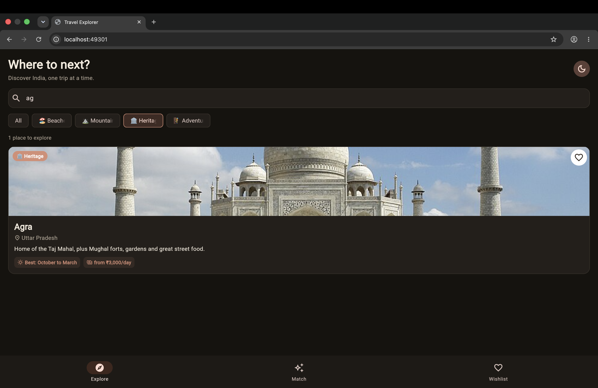
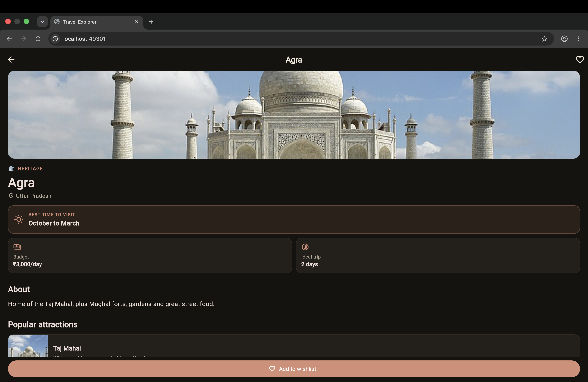
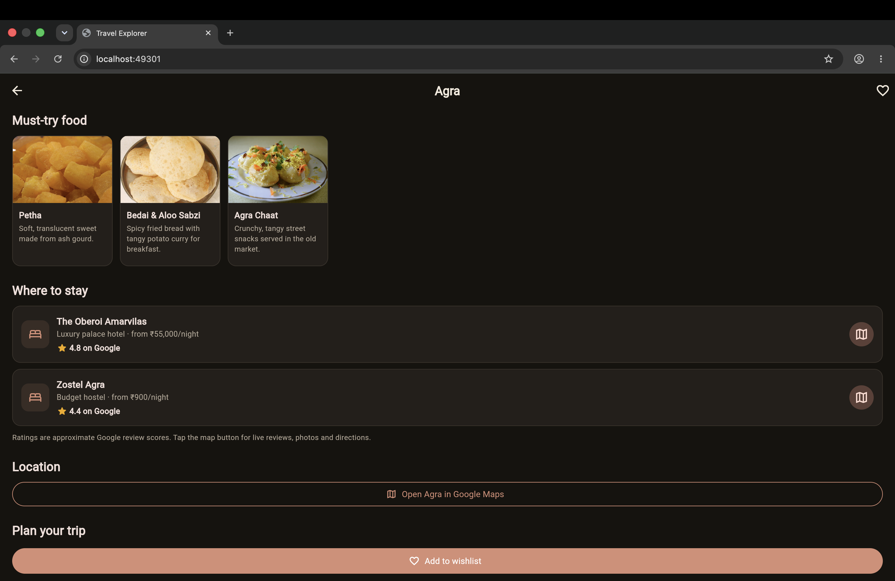
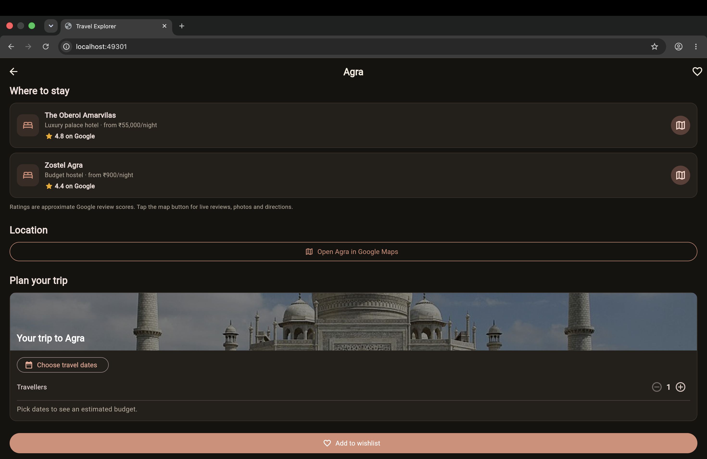
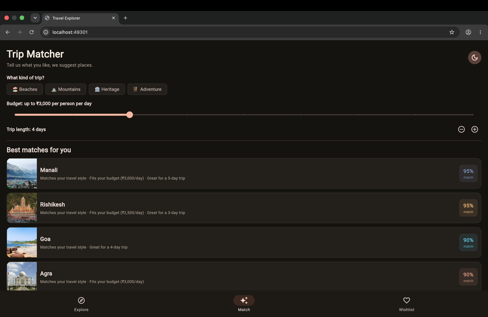
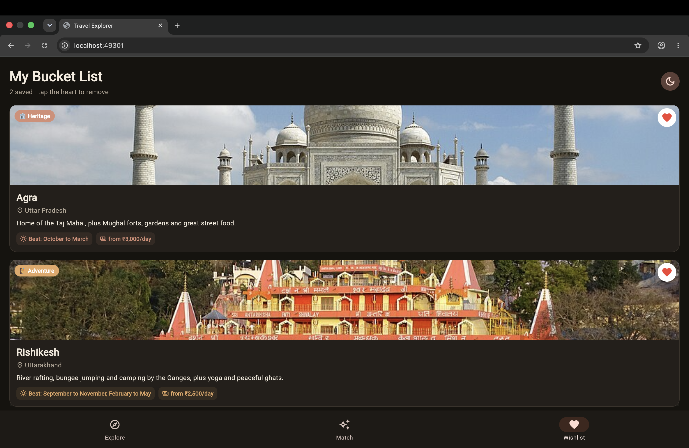
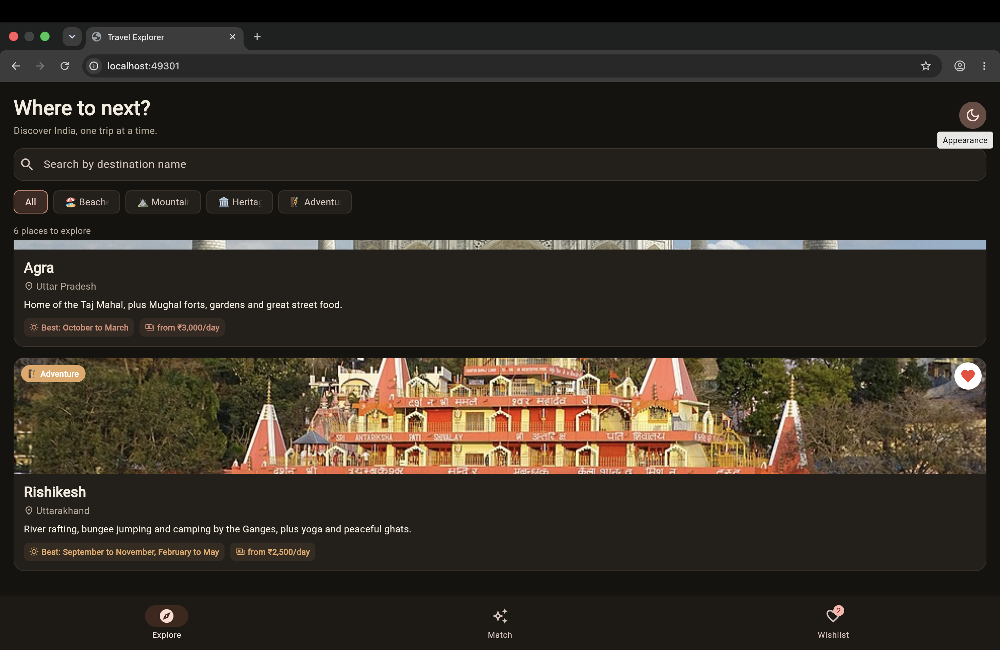
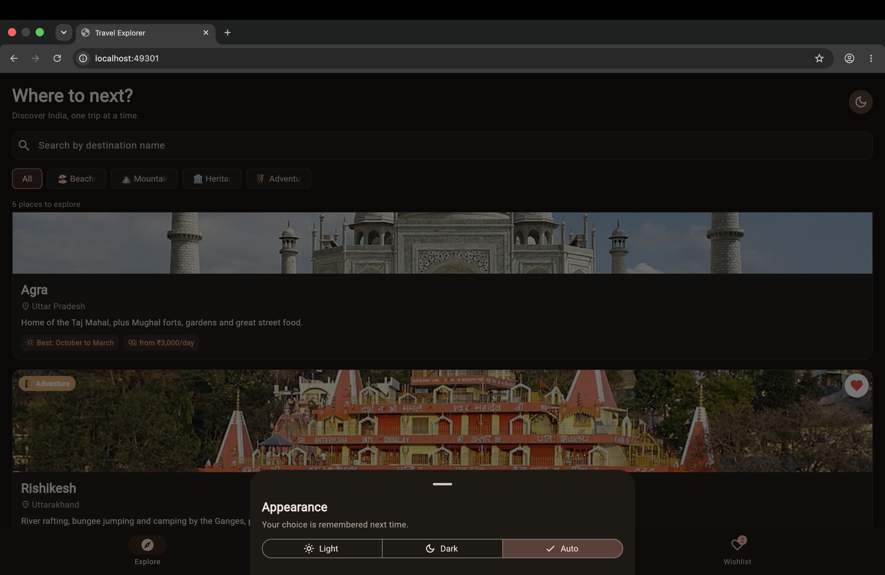

# 🧭 Travel Explorer

A Flutter app that helps you discover beautiful destinations across India, save your favourites and plan a trip, all in a warm "travel journal" style with light and dark themes.

Built for the **GDGC VNRVJIET App Development Volunteer Recruitment Assignment**.

---

## 📖 Project Overview

Travel Explorer lets a user browse six Indian destinations across four categories (Beaches, Mountains, Heritage, Adventure). For each destination the user can read a short description, see the best time to visit, explore popular attractions, discover must-try local food, find recommended stays, open the place in Google Maps, and plan a trip with dates, number of travellers and a budget estimate.

Everything the user saves (wishlist, planned trips, theme choice) is stored on the device and is still there after the app is closed and reopened. No backend or account is needed.

**Tech stack:** Flutter · Dart · `shared_preferences` · `url_launcher` · `http`

---

## ✨ Features

### Core requirements
| Stage | Feature | Status |
|---|---|---|
| 1. Discovery | 6 destinations in 4 categories, each with image, name, location and category | ✅ |
| 2. Details | Navigation between Home, Details and Wishlist; short description; best time to visit; 3 popular attractions with images and names | ✅ |
| 3. Search & Filter | Search by destination name and filter by category, working together | ✅ |
| 4. Wishlist | Add, remove, separate Wishlist screen that updates instantly | ✅ |

### Extension challenge
- 💾 **Local storage:** wishlist and trips survive an app restart
- 🗺️ **Google Maps integration:** open every destination and every recommended stay in Google Maps
- 🎯 **Smart Destination Matcher:** choose travel style, daily budget and trip length to get ranked suggestions with a match percentage and reasons

### Extra features
- 🍛 **Must-try food:** three local dishes per destination, with photos
- 🏨 **Recommended stays:** a premium and a budget option per destination, with an approximate Google rating and a map button
- ✈️ **Trip planner:** photo banner, travel dates, number of travellers, estimated budget, and a countdown ("starts in 21 days") on the wishlist
- 🌗 **Light, Dark and Auto theme**, chosen by the user and remembered
- 🎨 **Category colours and emojis:** every category has its own colour that adapts to light and dark mode
- 🖼️ **Smart photo lookup:** photos are found at runtime from Wikipedia, with a friendly placeholder if one can't be loaded

---

## 📸 Screenshots

| Home | Search & Filter | Destination Details |
|---|---|---|
|  |  |  |

| Food & Stays | Trip Planner | Trip Matcher |
|---|---|---|
|  |  |  |

| Wishlist | Dark Theme | Theme Picker |
|---|---|---|
|  |  |  |

_Screenshots are stored in the [`screenshots/`](screenshots) folder._

---

## 🚀 Setup Instructions

### Prerequisites
- [Flutter SDK](https://docs.flutter.dev/get-started/install) (Dart 3.0 or newer)
- Google Chrome (to run the app in the browser)
- Any code editor, such as VS Code with the Flutter extension
- An internet connection (needed for photos and Google Maps links)

Check that everything is ready:
```bash
flutter doctor
```

### Run the app
```bash
# 1. Clone the repository
git clone <your-repository-url>
cd travel_explorer

# 2. If the project has no web folder yet, add web support (safe to run again)
flutter create . --platforms=web

# 3. Install the packages
flutter pub get

# 4. Run in Chrome
flutter run -d chrome
```

While the app is running in the terminal, press `r` for a quick reload or `R` for a full restart.

### Run on a phone (optional)
Connect an Android device or start an emulator, then run `flutter run`.

---

## 🗂️ Project Structure

```
lib/
├── main.dart                  App start, theme switching, bottom navigation
├── theme.dart                 Colours, fonts, light and dark themes
├── utils.dart                 Date and rupee formatting, Google Maps opener
├── models/
│   └── destination.dart       Destination, Attraction, Food, Stay, TripPlan
├── data/
│   └── destinations.dart      All destination content in one place
├── services/
│   ├── app_state.dart         Wishlist, trips, theme + saving on the device
│   └── image_service.dart     Finds photos from Wikipedia
├── screens/
│   ├── home_screen.dart       Search, category chips, destination list
│   ├── details_screen.dart    Full destination page and trip planner
│   ├── matcher_screen.dart    Smart Destination Matcher
│   └── wishlist_screen.dart   Saved destinations
└── widgets/
    ├── destination_card.dart  Destination card used on Home and Wishlist
    ├── safe_image.dart        Image with a friendly placeholder
    └── screen_header.dart     Page title and theme picker
```

---

## 🧠 How It Works

- **State management:** a single `AppState` (a `ChangeNotifier`) holds the wishlist, trips and theme. Screens listen to it with `ListenableBuilder`, so the heart icon, wishlist screen and badge all update together.
- **Persistence:** `AppState` saves to `shared_preferences` whenever something changes and reads it back when the app starts.
- **Search and filter:** the Home screen keeps the search text and selected category, and shows only destinations that match both.
- **Photos:** each place in `destinations.dart` has a search phrase. `ImageService` asks Wikipedia's search API for that page's main image and remembers the result. You can also use your own picture by saving it in `assets/images/` and writing `'assets/images/yourfile.jpg'` instead of a phrase.
- **Trip Matcher scoring:** travel style (50 points), budget fit (30) and trip length (20) are added up to give each destination a score out of 100.
- **Budget estimate:** `daily cost per person × travellers × days`.

---

## 📝 Notes

- Hotel ratings are **approximate** Google review scores added by hand. Use the map button on each stay to see live ratings and reviews.
- Budgets per day are rough estimates meant for planning, not exact prices.
- No backend, database or paid API is used.

---

## 🙌 Acknowledgements

- Photos from [Wikipedia / Wikimedia Commons](https://commons.wikimedia.org)
- Built with [Flutter](https://flutter.dev)

**Author:** _your name_ · _your email or GitHub profile_
